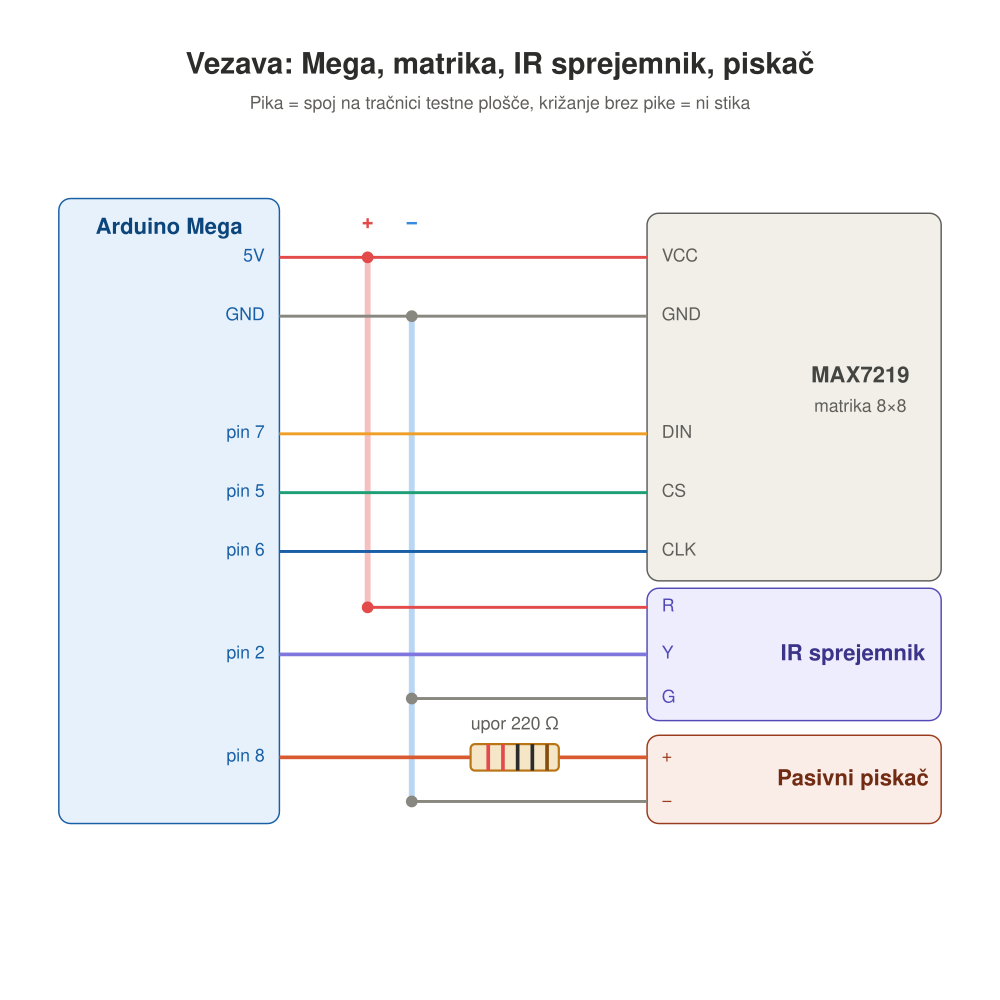
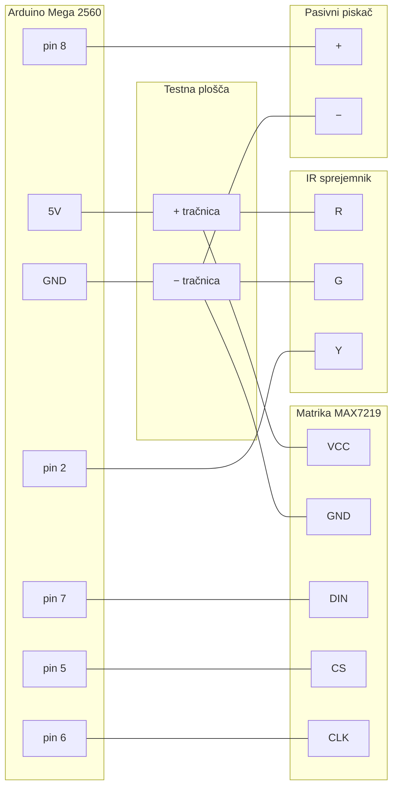

# Eksperimentiranje z robotiko

Ta repozitorij vsebuje kodo za eksperimente iz področja robotike in elektronike.

# Oprema

- **Plošča:** ELEGOO MEGA 2560 R3 (združljiva z Arduino Mega 2560)
- **Mikrokrmilnik:** Microchip (Atmel) ATmega2560, 8-bitni AVR, 16 MHz
- **Pomnilnik:** 256 KB flash (8 KB zaseda zagonski nalagalnik), 8 KB SRAM, 4 KB EEPROM
- **Priključki:** 54 digitalnih pinov (15 s PWM), 16 analognih vhodov, 4 serijska vrata (UART)
- **Napajanje:** 5 V prek USB ali 7–12 V prek priključka za adapter
- **Programiranje:** USB, v Arduino IDE ali `arduino-cli` z oznako plošče `arduino:avr:mega`

## Vezava



Napajanje gre iz Mege na tračnici testne plošče (5V na rdečo **+**, GND na modro **−**), od tam pa na vse module.

| Modul | Nožica modula | Kam na Megi |
|---|---|---|
| Matrika MAX7219 8×8 | VCC | 5V (rdeča tračnica +) |
| | GND | GND (modra tračnica −) |
| | DIN | pin 7 |
| | CS | pin 5 |
| | CLK | pin 6 |
| IR sprejemnik | G | GND (modra tračnica −) |
| | R | 5V (rdeča tračnica +) |
| | Y (signal) | pin 2 |
| Pasivni piskač | + (daljša nožica) | pin 8, prek upora 220 Ω (tišji zvok; brez upora je glasneje) |
| | − | GND (modra tračnica −) |


Programi, ki uporabljajo daljinec in piskač hkrati, morajo pred `#include <IRremote.hpp>` imeti `#define IR_USE_AVR_TIMER5`, ker `tone()` in knjižnica za daljinec sicer uporabljata isti časovnik.

## Programi

| Program | Kaj dela | Uporablja |
|---|---|---|
| [Blink](Blink/) | utripa vgrajena LED (pin 13) | samo ploščo |
| [Kaca](Kaca/) | kača sama lovi pikice | matrika |
| [Pikica](Pikica/) | pikico premikaš z daljincem | matrika, IR |
| [KacaDaljinec](KacaDaljinec/) | kača na tipke, pobiraš pikice in rasteš | matrika, IR |
| [Kockice](Kockice/) | padajoče kocke, polne vrstice izginejo; ob koncu pokaže število vrstic | matrika, IR, piskač |
| [Formula](Formula/) | voziš formulo po vijugasti cesti mimo ovir | matrika, IR |
| [Odbijanje](Odbijanje/) | z loparjem odbijaš žogico, sproti se pojavljajo ovire; ob koncu pokaže točke | matrika, IR, piskač |

Tipke na daljincu: VOL+ gor, VOL− dol, |◀◀ levo, ▶▶| desno (ali številke 2, 8, 4, 6). V Kockicah VOL+ zavrti kos, VOL− ga spusti hitreje; v Formuli VOL+/VOL− menjata prestavo. Tipka ▶|| v igrah ne naredi nič.

## Nalaganje programov

Vsak program je v svoji mapi (npr. `Kaca/Kaca.ino`). Skripta `nalozi.sh` ga prevede in naloži na ploščo; vrata poišče sama.

```bash
./nalozi.sh                 # seznam programov
./nalozi.sh Kaca            # prevedi in naloži
./nalozi.sh Kaca -m         # naloži in prikazuj serijski izhod (Ctrl+C za izhod)
./nalozi.sh Kaca -p         # samo prevedi, ne nalagaj
./nalozi.sh -m              # samo prikazuj serijski izhod
```

## Authors

- Oto Brglez
- Rudi Brglez


